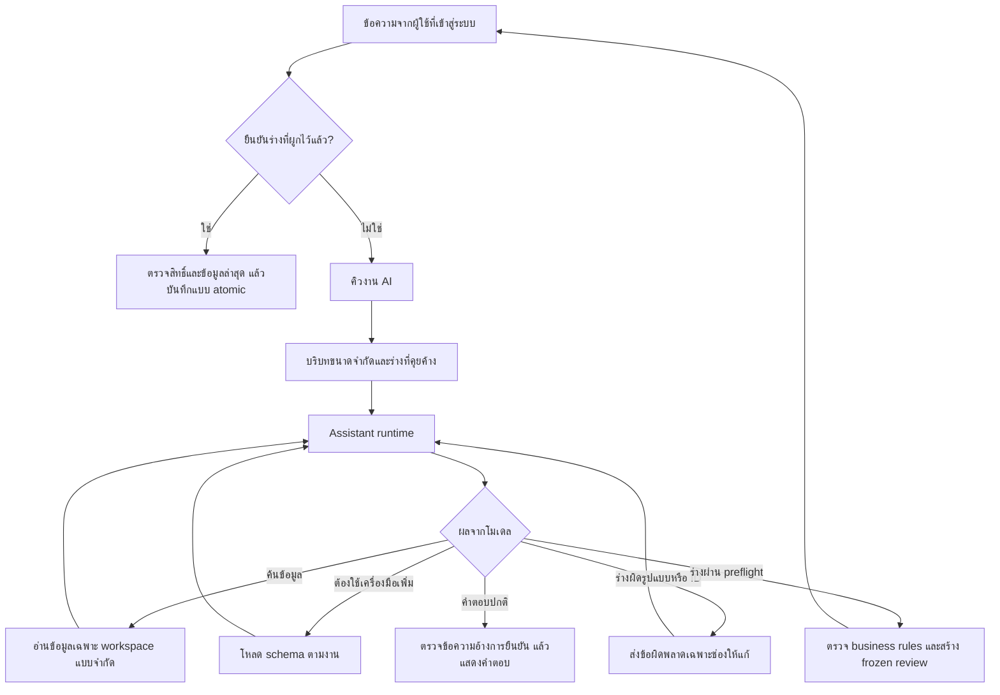

# โครงสร้าง AI Chat และผลการปรับปรุง

## Tool continuation และยอดคงเหลือ (14 ตุลาคม 2026)

`AssistantReply.continuation` เก็บ assistant message เดิมพร้อม `reasoning_content`, `reasoning` หรือ `reasoning_details` ที่ provider ส่งมา เฉพาะในหน่วยความจำของ converse รอบนั้นแล้ว replay กลับ provider ตัวเดิม จัดข้อความ system ของ backend เป็น prefix ก่อน user/tool เพื่อรองรับ strict chat templates รวมรอบ repair_review โดยไม่เปลี่ยนลำดับ tool pairs หรือยกระดับข้อความผู้ใช้ ทั้ง JSON/SSE ใช้ feedback path เดียวกัน รวมรอบแก้ arguments และแก้คำตอบที่มีตัวเลขผิด ไม่สร้าง assistant message ใหม่ที่ทิ้ง metadata เหล่านี้ Content ที่ไม่มีค่าใช้ empty string; tool call ID/arguments จับคู่กับผลเครื่องมือเดิม Private continuation จำกัด 64 KiB และ stream/turn limits เดิม ยังไม่ persist ลง Message, Conversation, Job diagnostics, usage หรือเผยแพร่ SSE/Telegram; ไม่ส่งต่อ provider สำรองหรือห้องถัดไป ไม่แสดงใน repr ของ AssistantReply

OpenRouter ที่เลือก effort ใช้ `reasoning.exclude=false` เพื่อให้ backend รับ continuation ที่อาจต้องใช้ต่อ โดยยังไม่แสดงหรือเก็บ reasoning ในประวัติ ผู้ให้บริการที่ไม่ส่ง fields นี้ยังใช้ protocol ปกติ ไม่มีการปิด Thinking หรือเปลี่ยน effort เงียบ ๆ อ้างอิง [Qwen thinking tool calls](https://docs.qwencloud.com/developer-guides/tool-calling/function-calling#thinking-mode) และ [OpenRouter reasoning continuation](https://openrouter.ai/docs/guides/best-practices/reasoning-tokens)

หาก fetch_finance/semantic plan หรือ lookup/query อ่านข้อมูลที่ authorize สำเร็จแล้ว แต่คำขอต่อโมเดลถูกปฏิเสธ/timeout/อ่านไม่ได้ ให้ส่ง fallback ของ actor-bound evidence ที่คำนวณแล้วพร้อม scope/references แทนการทิ้งยอดแล้วตอบ API error ไม่เพิ่ม model retries เมื่อมีข้อมูลตอบได้ ไม่อ้าง mutation สำเร็จ การบันทึกยังต้องมี draft และ typed confirmation เดิม Stop, membership, context และ workspace epoch ต้องผ่าน final fence อีกครั้ง หากยังไม่ได้อ่านจริงจะไม่สร้างยอด/ไม่ยืมคำตอบจากประวัติ AI Lab ไม่ใช้ทางกู้คำตอบนี้ จึงยัง fail เมื่อ provider continuation เสีย

Balance facts และ snapshot ของ legacy chat จำกัด account kind asset/liability เท่านั้น รายรับ/รายจ่าย/equity เป็นหมวดบัญชี ไม่ใช่กระเป๋าเงิน แสดง kind ของแต่ละบัญชีและแจ้งเมื่อรายการบัญชีมีเพียง 10 แรก แต่ assets/liabilities/net คำนวณครบทุกบัญชีตามตัวกรอง หมวดไม่ถูกส่งปนใน balance facts หรือจำนวนเงินที่ยอมรับให้ตอบ

Diagnostics เพิ่ม HTTP status และชื่อช่องจาก static allowlist เท่านั้น ไม่เก็บ upstream body, URL, key, argument, prompt หรือ reasoning แยก thinking_history/tool_history ออกจาก capability errors หน้า settings แสดงรายละเอียดที่ปลอดภัยและสถานะตอบจากข้อมูลที่ตรวจแล้ว คุณภาพคำเรียบเรียงยังขึ้นกับโมเดล และการรองรับ fields เฉพาะของ provider ที่นอกเหนือ protocol นี้ยังต้องทดสอบปลายทางจริง

## Plain calendar transport และ source-bound recovery (14 ตุลาคม 2026)

`assistant_calendar.parameters` แทนเฉพาะperiod/compare_periodในadvertised Fetch/Plan schemasด้วยdate-word stringหรือflat start/end ลดnested enum refsที่โมเดลมักส่งผิด Internal Window/boundsยังเป็นcanonical strict structure Aliases/Thai Buddhist dates/relative mathอยู่backendทั้งหมด ไม่เพิ่ม user-command routing grammar

`parse_fetch` จับเฉพาะperiod-only validation failure, ปฏิเสธextra/other-field errorsและnested object/arrayก่อนrecoverจากcalendar mentionเดียวในactualownedUserMessage source ห้ามchoose-firstเมื่อdate hintsขัดกัน ถ้าละperiodหรือboundsไม่ครบ ใช้source hintเดียวที่ชัดก่อนdefault แทนการinheritช่วงเก่าหรือfallbackเดือนนี้ การอ่านexplicit valid rangeเพื่อเพิ่มบริบทยังทำได้ Explicitfilters/authority/boundsยังvalidateหลังซ่อม Date-only followup require adjacentsource ID+room scope+15min expiry ไม่ใช้assistantclaimsเป็นsource Metadata errorsยังsanitizedและมีcalendar repairexamplesภายใน

Sandboxใช้parserเดียวกันกับpromptสังเคราะห์ มีcoffee/cafe literal fixtureและdinnerdistractorเพื่อทดสอบscopeโดยไม่ต้องส่งexact qstringแบบลับ ยอด80/count1และวันที่MTDยังตรวจเหมือนเดิม แยกinvalidargumentsจากanswer mismatch ไม่มีledgerreadหรือrealprovider assuranceจากmock tests

## Direct reads and ordinary prose — 14 ตุลาคม 2026 (เส้นทางปัจจุบัน)

- `assistant_data.Fetch` / `fetch_finance` เป็น primary direct read tool ใน initial catalog; `understand_request` เป็น optional plan สำหรับงานซับซ้อน ไม่บังคับ plan→respond สำหรับคำถามอ่านข้อมูล User text ไม่เข้าตัว parser นี้ มีเฉพาะ tool arguments จากโมเดลที่ normalize internal calendar aliases แล้วตรวจ strict schema; ไม่มี tenant/user/SQL/confirmation fields
- `assistant_data.authorize` join conversation + membership + active workspace ทุก direct/lookup read โดย bind job.user_id/job.workspace_id/job.conversation_id และตรวจ room owner ไม่ใช้ authority ที่ส่งจากโมเดล ประกอบกับ initial worker authorization และ final workspace/epoch/context/stop fence เดิม Shared workspace ledger เป็นทรัพยากรร่วมเฉพาะสมาชิกที่ได้รับสิทธิ์; room และ preferences ยังคง user-private
- Direct read ใช้ structural semantic resolution + verified SQL เดิม รับชื่อที่ resolve ภายใน workspace หรือ UUID ที่ตรวจ scoped kind แล้วเท่านั้น Defaults: summary/analytics month-to-date, transactions last30days, budgets current month, balances current cumulative; max366วัน Pagination ผ่าน scoped cursor และผล10รายการ มี full SQL totals, current-page facts และ search selection context สำหรับ corrections; source refs รวมหลายชุด bounded24
- Evidence job-local สูงสุด3datasets bind actor tuple(user,workspace,room) ไม่อนุญาต reuseข้ามคน/ห้อง `natural` รับ normal prose/Markdown และตัวเลขปกติ/เลขไทย เทียบ numeric quantities/units จาก bounded backend facts รวม optional placeholders เพื่อ compatibility ตรวจเลข substring, unknown amounts, fake write/review claims ไม่รับ model URLs; scopeและlinksมาจาก backend ไม่ส่ง key/SQL/raw errorsเข้าmodel
- Plain prose responseไม่ต้องมี tool call; ถ้าตัวเลขไม่ผ่านให้ซ่อมภายในก่อน fallbackจากข้อมูลจริง ไม่บังคับให้ผู้ใช้พิมพ์ใหม่ตามformat ยังจำกัด3successful reads/2repairs/8model requestsและ deadline90s; sourcecacheในlegacy pathที่ยังไม่มีsemantic/directscopeรักษา independent question scope ไม่แทนรายจ่ายด้วยยอดบัญชีที่อ่านมาประกอบ
- AI Lab natural scenario รองรับ fetch+plain reply ผ่าน production runtime แต่ fake adapterส่งเฉพาะsynthetic facts ไม่ resolveแหล่งข้อมูลจริง ส่วนการอ่าน/เตรียมจริงและledger mutationยังแยกจากsandbox การตรวจnumeric provenanceไม่พิสูจน์semantic correctnessของข้อความหรือfilterที่โมเดลเลือก และไม่รับรองlatency/qualityของQwen/Gemmaจริง
- ไม่มี env/schema migration/route changes; provider routing/privacyและmanual confirmationคงเดิม ข้อความอ่านข้อมูลที่แจ้งว่าจะมีร่างรอยืนยันโดยยังไม่มีpreparetool ถูกส่งกลับให้โมเดลสร้างร่างจริงหรือแก้คำตอบ ไม่ส่งphantom reviewให้ผู้ใช้

วันที่ 11 ตุลาคม 2026 — โฟกัสความต่อเนื่องของบทสนทนา การเรียก tools และต้นทุนบริบท ไม่รับรองคุณภาพโมเดลจริงจากผล mock tests

## จุดที่ตรวจพบและแก้แล้ว

| ปัญหาเดิม | การเปลี่ยนแปลง |
|---|---|
| ส่งคำสั่งยาวและ schema จัดการทุกประเภททุกครั้ง | แยก core tools กับ `load_toolkit`; เรียก management เมื่อจำเป็น และเปิด corrections หลังค้นรายการหรือโหลดเอง |
| ร่างผิดชนิดข้อมูล/ID แล้วจบด้วยให้ผู้ใช้เริ่มใหม่ | ตรวจ schema และ account references ก่อนส่งออกจาก runtime ส่ง field errors ที่ไม่รวม input กลับให้โมเดลแก้ ภายในขอบเขตจำกัด |
| อ้างอิงร่างที่ถามค้างผ่านประวัติข้อความเป็นหลัก | เก็บ typed partial draft + ช่องที่ขาด 15 นาที รวมรายการทั้งหมดใน batch ส่งให้โมเดลเฉพาะห้อง/ผู้ใช้เดิม |
| cache แยกค่าที่เว้นกับค่า default และผลอ่านอาจหายจากบริบทเมื่อ retry | canonical read keys จาก typed models และใส่ผลที่ cache กลับใน tool protocol ของรอบใหม่ |
| จำกัดรอบเป็นส่วน ๆ แต่ retry/fallback เพิ่มจำนวนคำขอรวมได้มาก | จำกัดสูงสุด 8 model requests ต่อการประมวลผลหนึ่งงาน รวม retry/fallback; จำกัด reads สำเร็จ 3 ครั้ง และ invalid tool responses 2 ครั้ง |
| เตรียมรายการ/ใช้ defaults แล้วโหลด accounts ทั้ง workspace | อ่านเฉพาะ IDs/กฎที่ตรง ตรวจบัญชีเดียวด้วย limit 2 และเสนอชื่อไม่เกิน 6 ชื่อเมื่อถามเพิ่ม |
| หน้าแชทแสดงแค่กำลังคิด | SSE progress ระบุการค้นข้อมูล ตรวจร่าง แก้คำสั่ง และสรุป; ไม่ส่ง arguments หรือ private thinking |

## เส้นทางการทำงาน

- `assistant_context.py`: คำสั่งหลักและข้อมูลร่างที่ถามค้าง
- `assistant_tools.py`: catalog, discovery schema, typed preflight และ canonical read keys
- `assistant_runtime.py`: วงรอบอ่าน/แก้/เตรียม/ตอบ พร้อม request budget และ progress
- `chat_dialogue.py`, `assistant_management.py`, `assistant_finance.py`: ตรวจข้อมูลจริงและเตรียมร่างตามประเภทงาน
- `chat_actions.py`: authenticated confirmation, stale checks, idempotency และการบันทึกจริง

การโหลด schema เป็นการลดบริบท ไม่ใช่ขอบเขตสิทธิ์ เครื่องมือที่ลงทะเบียนทุกตัวต้องตรวจ tenant/user และกฎของงานตามเดิม โมเดลไม่สามารถเพิ่มเครื่องมือเองหรือยืนยันแทนผู้ใช้ การตรวจ preflight ไม่ใช่หลักฐานว่าร่างผ่าน business rules ทั้งหมดหรือบันทึกแล้ว

## ผลวัดขนาดบริบท

วัดด้วยชื่อ workspace ตัวอย่างเดียวกัน เฉพาะ system instruction + tool schemas เริ่มต้นใน UTF-8:

- ก่อน: 26,405 bytes (instruction 10,893)
- หลัง: 12,814 bytes (instruction 5,151)
- ลด 51.5%; ไม่รวมประวัติ รูป และผล tool ไม่ใช่การวัด tokens, latency หรือใบแจ้งหนี้ของ provider เมื่อโหลดชุดเพิ่มเติมบริบทจะใหญ่ขึ้นตามงาน

## ขอบเขตและงานต่อไป

- ร่างที่คุยค้างเป็น state จากข้อมูลที่ผ่าน schema ไม่ใช่การจำถาวรหรือหลักฐานธุรกรรม ล้างเมื่อสร้าง review/ยกเลิก และไม่ส่งเมื่อพ้น 15 นาที การยืนยันยังต้องอิง frozen review จริง
- จำนวน 8 คำขอเป็นขอบเขตในการประมวลผลหนึ่งครั้ง ถ้า worker crash และทำงานใหม่ยังไม่ใช่ durable billing cap งบใช้งานมีระบบ reserve/accounting เดิม
- Worker ยังถือ transaction/workspace write lock ระหว่าง inference การอ่านหน้าเว็บไม่รอ lock แล้ว แต่งานเขียนใน workspace เดียวกันอาจรอ งานถัดไปควรแยก inference ออกจาก transaction โดยใช้ durable usage reservation, request ownership/version และตรวจ membership/evidence ใหม่ก่อน commit ไม่ควรปลด lock อย่างเดียว
- parser ยังรับหนึ่ง tool call ต่อคำตอบ; lookup รวม queries ได้สามรายการ ไม่ได้เพิ่ม parallel tool calls หรือเปิด SQL อิสระ
- AI Lab เป็น synthetic provider smoke test ส่วน regression บทสนทนาต่อเนื่องทดสอบ runtime จริงกับ HTTP mocks การรับรอง Gemma/Ollama จริงต้องทดสอบจากเครื่องปลายทางและการตั้งค่าของผู้ใช้

## รายงาน Gemma และการแก้ compatibility รอบถัดมา

ผลจริงจากผู้ใช้พบ batch item ขาด `transactions.intent` ซ้ำ จึงให้รายการย่อยใช้ `create` เป็น default ส่วน intent ระดับคำขอยังจำเป็นต้องระบุ ไม่มีการเดายอดหรือ ID และ business validation/confirmation เดิมยังทำงานทั้งหมด

AI Lab ให้โอกาสแก้ prose ที่ไม่ได้เรียก prepare_transaction อีกหนึ่งรอบภายใน call/time budget เดิม ต้องได้ typed draft ที่ตรวจผ่านจริงจึงผ่าน ไม่บันทึกจากข้อความ และไม่เดายอดสลิปจากจำนวนที่โจทย์คาดหวัง

แยก finish_reason=length เป็น output_limit ทั้ง streaming และ JSON responses ของ runtime/lab เพื่อบอกให้ปรับ output tokens/Thinking ได้ตรงจุด ตัวเลข output ที่ estimated ใน diagnostics ใช้เพดานการตั้งค่าสำหรับ reservation ไม่ใช่จำนวน tokens ที่วัดจาก provider จึงแสดงคำอธิบายตรงหน้า UI

รายงานเดิมที่ไม่มีคำตอบ/finish_reason ไม่เพียงพอพิสูจน์ว่ารายเดือนผิดเพราะการแปลงหน่วยหรือข้อความถูกตัด และไม่อาจระบุสาเหตุ transactions invalid ของสลิปได้แน่ชัด การแก้นี้ไม่รับรองว่า Gemma ทุกรุ่นจะผ่านทุกโจทย์ ต้องทดสอบจริงหลังอัปเดต ไม่ผ่อนเกณฑ์ยอดเงินเพื่อทำให้ผลผ่าน

## เครื่องมือตอบยอดที่ตรวจสอบแล้ว

`answer_finance_summary` เป็น read-only terminal tool สำหรับคำถามยอดคงเหลือรวมและสรุปรายเดือนทั้ง workspace เครื่องมืออ่านผ่าน scoped lookup/report เดิม แล้วแสดงยอดจาก integer satang โดยตรง ไม่ต้องให้โมเดลคำนวณหรือเขียนจำนวนเงินซ้ำ ช่วยจบงานมาตรฐานในหนึ่ง model request เมื่อเลือกเครื่องมือนี้ รายเดือนมีรายรับ รายจ่าย ผลต่าง และสูงสุดห้าหมวด พร้อม evidence links จาก backend

เดือนผิดรูปแบบ/เดือนที่ไม่มีจริงและตัวกรองที่ไม่รองรับถูกปฏิเสธและส่งให้โมเดลแก้ ไม่ละเลยตัวกรองเงียบ ๆ คำถามเจาะบัญชีหรือวิเคราะห์ซับซ้อนยังใช้เครื่องมือค้นเดิม ไม่ใช่การรับรองตัวเลขในคำตอบอิสระของโมเดลทั้งหมด และการเลือกเครื่องมือยังขึ้นกับโมเดล AI Lab รองรับเครื่องมือนี้ด้วยข้อมูลสังเคราะห์ ไม่มีการเขียนบัญชีหรือสร้างร่างจากคำถามรายงาน

## Audit fixes — 12 ตุลาคม 2026 (แทนข้อจำกัดเรื่อง write lock ข้างต้น)

- `assistant_evidence.py` ตรวจขอบเขตจากคำขอผู้ใช้และบริบทที่ backend ตรวจแล้ว: ยอดปัจจุบัน/ช่วงรายรับรายจ่าย, บัญชี/หมวด, วันที่ และการถามต่อที่ยังไม่หมดอายุ คำถามไม่ชัด หลายบัญชี/หมวด หรือยอดย้อนหลังที่ยังไม่รองรับต้องถามเพิ่ม ไม่แปลงเป็นยอดรวมเงียบ ๆ
- คำตอบการเงินในเส้นทางที่รองรับสร้างจาก scoped backend reads หรือรายการที่เครื่องมืออ่านได้ ไม่ใช้จำนวนเงินใน free prose ของโมเดล ข้อความอ้างทำสำเร็จไม่มีสิทธิ์เป็นหลักฐานบันทึก การบันทึกจริงยังอยู่ใน confirmation endpoint เท่านั้น งาน mutation ต้องส่ง typed draft; หากโมเดลไม่ทำ ระบบไม่อ้างว่างานเสร็จ
- Raw assistant streaming previews ถูกพักไว้ ส่งเฉพาะ progress และคำตอบที่ commit แล้ว เพื่อไม่ให้ยอด/คำอ้างผิดหลุดขึ้นจอชั่วคราว ปุ่มหยุดยังใช้ durable control เดิม
- Cache hit และ read limit ใช้ renderer ที่ตรงกับคำถาม/ข้อมูลล่าสุด ไม่เลือก balances เพียงเพราะเคยอ่านไว้ และไม่เรียกโมเดลเพิ่มเพื่อเขียนตัวเลขซ้ำ
- AI Lab ใช้ `assistant_runtime.converse` เดียวกับแชท ผ่าน synthetic adapter ที่ไม่มีสิทธิ์อ่านบัญชีจริงหรือสร้างร่างใน DB ผลผ่านหมายถึงผลลัพธ์หลังตรวจ ไม่ใช่การรับรองข้อความดิบของโมเดล เลิกตรวจแค่ว่ามีเลขที่คาดหวังอยู่ในข้อความ
- Worker ใช้ connection-scoped advisory ownership ต่อ job/workspace แทน workspace row lock ระหว่าง network inference ไม่ flush mutations ขณะรอ; HTTP writes ทำงานได้ และ worker สอง thread ทำต่าง workspace ได้ (AI_WORKERS 1–4, default 2)
- Usage reservation อยู่ใน transaction สั้นแยกต่างหากและ commit ก่อนส่งคำขอ ถ้า process crash ยอดจองยังอยู่เพื่อไม่ให้ overspend; ไม่ลดค่า reservation ที่ไม่ทราบ usage จริงอัตโนมัติ
- Migration `ai_evidence_epoch` เพิ่ม counter ที่ trigger เปลี่ยนเมื่อข้อมูลการเงิน/สิทธิ์/การตั้งค่าที่เกี่ยวข้องเปลี่ยน ก่อน commit ต้องล็อก workspace ช่วงสั้น ตรวจ epoch, membership, job/room existence, current user turn, room context และ stop fence ถ้าข้อมูลเปลี่ยนให้ยกเลิกผลเก่าและแจ้งส่งใหม่ การยืนยันร่างยังตรวจ stale/duplicate ตามเดิม
- Provider connection probe ปล่อย HTTP authorization lock ก่อน network I/O งานเก่าที่มีคำขอใหม่กว่าไม่เรียกโมเดลและไม่ทับ review ใหม่

ข้อจำกัดที่ยังต้องทราบ: การตีความภาษาธรรมชาติไม่ได้รองรับทุกประโยค ถ้าระบุขอบเขตไม่ได้ระบบขอเพิ่ม ไม่รับรองคุณภาพ Gemma จาก mocks และยังเก็บ read transaction/connection ระหว่าง inference (ไม่มี workspace write lock) Schema/catalog ยังคงหนึ่ง tool call ต่อ model reply ต้องทดสอบกับ provider จริงต่อ จำนวน request cap ยังต่อ processing attempt; ค่าใช้จ่าย reserve คงอยู่ข้าม crash แต่ไม่ได้อ้างว่า provider ยกเลิกคิดเงินเมื่อกดหยุด

## Audit fixes — 2026-10-14

- `assistant_scope.py` is the shared typed request scope. Preserve account/category/description q/date range through SQL aggregation and rendering. Month arguments from summary tools must match independently resolved user dates; unresolved date syntax does not silently default to the current month.
- `assistant_render.py` renders period totals, current/previous month comparisons, budget remaining and numbered transaction rows from backend data. Filtered totals cover all matches, not the first search page. Names remain untrusted display data; human confirmation is still required for every mutation.
- TelegramDelivery now has its own delivery ID, optional unique job ID, scoped reply message or notice body, and creation order. Linked synchronous replies commit with the outbox, including ledger confirmation receipts; AI jobs preserve their existing ID mapping. Delivery, access checks, retry, multipart acknowledgement, reset cancellation and confirmation gating use the same queue. Migration `telegram_all_replies` preserves old queued job results and status CHECK constraints; SQLite/PG upgrade/downgrade tests cover populated legacy rows.
- AI Lab remains a small synthetic provider/tool check; production-scope golden tests additionally exercise the full request/render/confirmation path. It is not a certification of every real provider or language formulation.

## Model-assisted request interpretation — 2026-10-14

`request_interpreter.py` exposes a strict `interpret_request` tool in the standard chat catalog. It returns a validated Scope/terminal read answer, a static clarification, a guarded conversational answer, or a mutation toolkit transition. It never creates ledger entries or confirms drafts. Existing read/draft tools remain supported. Valid complete reads can terminate in one model request; mutation routing may use another round for the existing typed draft. The global request/repair/read limits, accounting, stop/context/epoch fences remain unchanged.

No workspace/user/SQL authority fields are accepted. Account/category phrases and q must come from an owned user message; partial names must resolve uniquely in the current workspace and proper account kind. Date modes are computed by backend against the quoted phrase, with mismatch/ambiguity rejected. Historical sources require same room/workspace/owner boundary, user role, last20 user messages and age≤15minutes; explicit newest dates/names override history. Request clarification stores only scoped source IDs/field/expiry in existing conversation JSON. A bounded user-message index (max8 short excerpts, JSON≤1600 chars) is untrusted user data before original history, not system instructions.

Read answers reuse evidence renderers/SQL totals and references. Conversational output still passes false-success/financial-evidence checks and strips think blocks; interpreting mutation requires the usual backend draft and independent authenticated human confirmation. No schema migration or new environment settings are needed. Diagnostics add only the allowed tool name/field issue metadata, never arguments or prompts. Production-scope golden tests use mock model/Telegram transport; this is not a real-provider quality score or expanded AI Lab certification.

## Analytics ช่วงอิสระ — 14 ตุลาคม 2026

- ขยาย typed `interpret_request` ด้วย `analytics`, `Analysis`, `compare_period`; ไม่มี SQL/tenant/IDs ใหม่จากโมเดล ใช้ scoped source/ชื่อ unique/วันและตัวกรองจาก interpreter เดิม ไม่เพิ่ม planning request แยกหรือส่ง rows ทั้งหมดให้โมเดล
- `analytics_plan.py` ตรวจ operation/metric/bucket/group กับโจทย์ วันสองช่วง และคำค้นที่รู้จักไม่หาย; `assistant_analytics.py` รวม SQL จาก `transaction_conditions` (active entries + workspace + literal filters) แล้วคำนวณอัตราส่วนด้วย Decimal และ round half up เฉพาะผลแสดง เงินต้นเป็น integer satang
- SQL aggregate ครบทุกหน้า เปรียบเทียบใช้เงื่อนไขเดียวกันสองช่วง Trend ใช้ CASE group ตามปฏิทินสูงสุด366ช่วง เติมศูนย์และ render12ช่วงท้าย Ranking aggregate ก่อน limit1–10 พร้อม group count และสัดส่วนยอดทั้งหมด ลำดับ ties ชื่อ/id คงที่
- คำอธิบายเชิงตัวเลขสร้างจากผลที่ตรวจแล้วโดย backend โมเดลเลือกขอบเขต/รูปแบบวิเคราะห์ ไม่มีสิทธิ์แทรกยอดอิสระหรือเดาสาเหตุ เพิ่ม branch ใน evidence boundary จึงใช้ stop/context/epoch final fences และ Telegram durable delivery เดิม ไม่เพิ่ม schema migration/env/provider calls
- ค่าเริ่มต้นรายจ่าย; รายรับเลือกชัด แยกไม่ปน transfer/card/opening; per-calendar-day denominator เป็นจำนวนวันเต็มของช่วงที่ขอ per-transaction denominator เป็นจำนวนรายการจริง ไม่ใช่เฉพาะวันที่มีรายการหรือรายการที่แสดง ฐานศูนย์/ไม่มีรายการไม่สร้าง infinity หรือหารศูนย์ ไม่อ้าง capacity/latency จากผลทดสอบหน่วย

## Colloquial read recovery — 14 ตุลาคม 2026

`assistant_questions.py` ตรวจคำถามอ่านข้อมูลแบบ fully consumed + relative period หนึ่งช่วงก่อนเรียก provider เฉพาะข้อความที่ไม่มี attachment ใน production `converse` (ไม่แทรก AI Lab sandbox) ทำให้คำถามตัง/ตังค์/ไรบ้างที่ชัดเจนไม่พึ่ง model tool/schema/q ภายนอก ไม่รับชื่อ/เลข/คำสั่งเขียน/ข้อความอื่นแบบ partial match และยังผ่าน stop check + final authorization/context/epoch fence เดิม อ่านด้วย evidence renderer และ transaction_conditions เดิม จึงไม่เพิ่ม SQL หรือเส้นทาง posting ใหม่

Shared relative-period resolver ใช้ Bangkok date, previous week Monday–Sunday และ weekday ที่ระบุ past/upcoming ชัด `Period.weekday` ตรวจ phrase ไม่รับวันที่เดา Bare weekday คืนคำถามวันที่ผ่าน backend; `weekday_question` JSON เก็บ origin/day/expiry900s และยอมรับ qualifier ต่อเฉพาะเมื่อ origin เป็น user message ก่อนหน้าในห้อง/workspaceนี้ ไม่มี migration อัปเดต grammar แบบ edge-only ใน fallback scope โดยรักษาคำอย่างกับข้าว/ละมุด และคง literal filters ที่ตรวจแล้วใน date followups แก้เฉพาะ legacy filler query ที่พิสูจน์จากรายงานผู้ใช้ ไม่แก้ ledger

การแสดง `repairing` เปลี่ยนเป็นตรวจคำถาม/เงื่อนไข และ filtered income/expense cards/renderers ไม่อ้างยอดอีกชนิดเป็นศูนย์ทั้งหมด คำถามอื่นยังใช้ bounded model runtime เดิม ผลการทดสอบข้อมูลสังเคราะห์ไม่ใช่การยืนยัน server/model จริงทุกสำนวน

## Model-led conversational path — 14 ตุลาคม 2026

- Production catalog ใช้ `understand_request` เป็น primary และถอด legacy `interpret_request` จาก initial catalog แต่ยังรับ protocol เดิมเพื่อ compatibility `respond_finance` โหลดเฉพาะหลังอ่านสำเร็จ ไม่เพิ่ม schema ทุกคำขอแรก ลดการแข่งขันระหว่างสองเครื่องมือตีความ
- `semantic_assistant.Plan` แยก balances/report/transactions/budget/analytics/mutation/conversation/clarify รับชื่อ canonical/unique partial ภายในworkspaceเท่านั้น ไม่มี user/tenant/SQL/confirmation fields ใช้ source ที่เป็น user ในห้อง/workspaceเดิมและ recent bound เดิม Range/date enums ตรวจโครงสร้าง ไม่ตรวจว่าภาษาของผู้ใช้ต้องตรง regex/phrase/ISO Window relative arithmetic อยู่ backend; arbitrary range จาก model ต้อง≤366วันและแสดงใน scope
- `reuse_previous_scope`, explicit q clearing และ `clear_filters` ใช้ contextที่ backendเก็บ/ยังไม่หมดอายุ โหลดIDsใหม่ภายในworkspace ยอดบัญชีไม่inherit category/q/transaction_kind จากการถามรายจ่าย ชื่อเล่นเชิงความหมายเลือกโดยโมเดล ไม่อ้างว่า backendพิสูจน์ความหมายถูกจากชื่อเพียงอย่างเดียว
- Read prepare ใช้ verified renderer/SQL เดิม เก็บ fallbackจริง และส่ง bounded preformatted facts (integer satang→บาท) ไม่ส่ง transaction table ทั้งหมด สังเคราะห์ด้วย `respond_finance` text+fact placeholders เติมค่าหลังตรวจว่าคีย์มีจริง/มีหลักฐานหลัก/ไม่มีตัวเลขอิสระหรือคำอ้าง execution เก็บ scopeและsource links ตัวเลขได้รับการตรวจ ไม่ได้รับรองว่าคำอธิบายเชิงความหมายหรือการเลือกตัวกรองของ LLM ไม่มีวันผิด
- Validation/missing-field errors เข้า internal repairก่อนโยนคำถามกลับ จำกัด2repairs/3successful reads/8model requests/soft deadline90s ร่วมของเดิม ถ้าตอบจากfactsยังไม่ผ่านคืนfallbackจริง ถ้าอ่านแผนไม่สำเร็จไม่เดายอดจากlegacy grammar เรื่องทั่วไป/แนวคิดการเงินไม่ถูก blanket financial-word guard บล็อกในเส้นทางใหม่ แต่ personalized numeric claims/false write receipts ยังถูกปฏิเสธ
- AI Lab natural scenario เพิ่ม synthetic adapter ใช้ `Plan`, shared `bounds`, production converse/respond และตรวจrespondสำเร็จ Fake adapterไม่เรียก source/entity/prepare ที่อ่านDBจริง ตรวจ source accounting countsไม่เปลี่ยนและชื่อบัญชีจริงไม่เข้าprompt โมเดลต้องตีความ alias/ช่วงด้วยตัวเอง ไม่แจกคำตอบmodeในsystemprompt
- ไม่มี migration/env/provider-route changes ไม่ส่งkeysเข้าโมเดล และ final stop/context/epoch/authorization fencesยังครอบผลแชทเดิม General narrative quality/latency/token cost ยังต้องประเมินกับ provider จริง; เครื่องพัฒนามีเพียงdemo/test providers จึงไม่อ้างผล live Qwen/Gemma
