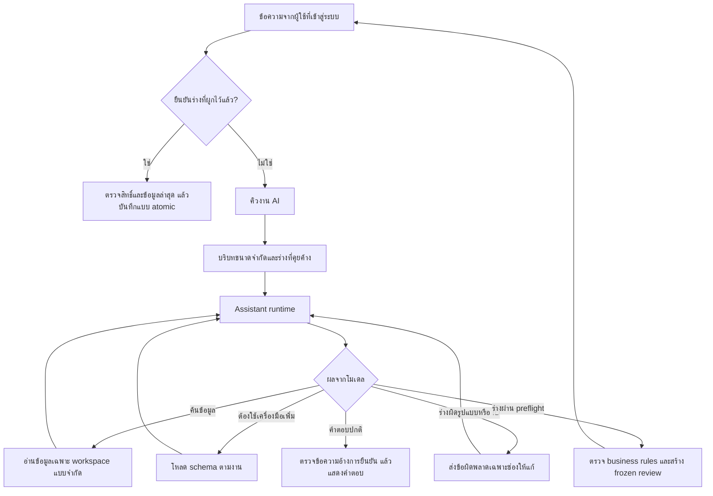

# โครงสร้าง AI Chat และผลการปรับปรุง

วันที่ 11 ตุลาคม 2026 — โฟกัสความต่อเนื่องของบทสนทนา การเรียก tools และต้นทุนบริบท ไม่รับรองคุณภาพโมเดลจริงจากผล mock tests

## จุดที่ตรวจพบและแก้แล้ว

| ปัญหาเดิม | การเปลี่ยนแปลง |
|---|---|
| ส่งคำสั่งยาวและ schema จัดการทุกประเภททุกครั้ง | แยก core tools กับ `load_toolkit`; เรียก management เมื่อจำเป็น และเปิด corrections หลังค้นรายการหรือโหลดเอง |
| ร่างผิดชนิดข้อมูล/ID แล้วจบด้วยให้ผู้ใช้เริ่มใหม่ | ตรวจ schema และ account references ก่อนส่งออกจาก runtime ส่ง field errors ที่ไม่รวม input กลับให้โมเดลแก้ ภายในขอบเขตจำกัด |
| อ้างอิงร่างที่ถามค้างผ่านประวัติข้อความเป็นหลัก | เก็บ typed partial draft + ช่องที่ขาด 15 นาที รวมรายการทั้งหมดใน batch ส่งให้โมเดลเฉพาะห้อง/ผู้ใช้เดิม |
| cache แยกค่าที่เว้นกับค่า default และผลอ่านอาจหายจากบริบทเมื่อ retry | canonical read keys จาก typed models และใส่ผลที่ cache กลับใน tool protocol ของรอบใหม่ |
| จำกัดรอบเป็นส่วน ๆ แต่ retry/fallback เพิ่มจำนวนคำขอรวมได้มาก | จำกัดสูงสุด 8 model requests ต่อการประมวลผลหนึ่งงาน รวม retry/fallback; จำกัด reads สำเร็จ 3 ครั้ง และ invalid tool responses 2 ครั้ง |
| เตรียมรายการ/ใช้ defaults แล้วโหลด accounts ทั้ง workspace | อ่านเฉพาะ IDs/กฎที่ตรง ตรวจบัญชีเดียวด้วย limit 2 และเสนอชื่อไม่เกิน 6 ชื่อเมื่อถามเพิ่ม |
| หน้าแชทแสดงแค่กำลังคิด | SSE progress ระบุการค้นข้อมูล ตรวจร่าง แก้คำสั่ง และสรุป; ไม่ส่ง arguments หรือ private thinking |

## เส้นทางการทำงาน

- `assistant_context.py`: คำสั่งหลักและข้อมูลร่างที่ถามค้าง
- `assistant_tools.py`: catalog, discovery schema, typed preflight และ canonical read keys
- `assistant_runtime.py`: วงรอบอ่าน/แก้/เตรียม/ตอบ พร้อม request budget และ progress
- `chat_dialogue.py`, `assistant_management.py`, `assistant_finance.py`: ตรวจข้อมูลจริงและเตรียมร่างตามประเภทงาน
- `chat_actions.py`: authenticated confirmation, stale checks, idempotency และการบันทึกจริง

การโหลด schema เป็นการลดบริบท ไม่ใช่ขอบเขตสิทธิ์ เครื่องมือที่ลงทะเบียนทุกตัวต้องตรวจ tenant/user และกฎของงานตามเดิม โมเดลไม่สามารถเพิ่มเครื่องมือเองหรือยืนยันแทนผู้ใช้ การตรวจ preflight ไม่ใช่หลักฐานว่าร่างผ่าน business rules ทั้งหมดหรือบันทึกแล้ว

## ผลวัดขนาดบริบท

วัดด้วยชื่อ workspace ตัวอย่างเดียวกัน เฉพาะ system instruction + tool schemas เริ่มต้นใน UTF-8:

- ก่อน: 26,405 bytes (instruction 10,893)
- หลัง: 12,814 bytes (instruction 5,151)
- ลด 51.5%; ไม่รวมประวัติ รูป และผล tool ไม่ใช่การวัด tokens, latency หรือใบแจ้งหนี้ของ provider เมื่อโหลดชุดเพิ่มเติมบริบทจะใหญ่ขึ้นตามงาน

## ขอบเขตและงานต่อไป

- ร่างที่คุยค้างเป็น state จากข้อมูลที่ผ่าน schema ไม่ใช่การจำถาวรหรือหลักฐานธุรกรรม ล้างเมื่อสร้าง review/ยกเลิก และไม่ส่งเมื่อพ้น 15 นาที การยืนยันยังต้องอิง frozen review จริง
- จำนวน 8 คำขอเป็นขอบเขตในการประมวลผลหนึ่งครั้ง ถ้า worker crash และทำงานใหม่ยังไม่ใช่ durable billing cap งบใช้งานมีระบบ reserve/accounting เดิม
- Worker ยังถือ transaction/workspace write lock ระหว่าง inference การอ่านหน้าเว็บไม่รอ lock แล้ว แต่งานเขียนใน workspace เดียวกันอาจรอ งานถัดไปควรแยก inference ออกจาก transaction โดยใช้ durable usage reservation, request ownership/version และตรวจ membership/evidence ใหม่ก่อน commit ไม่ควรปลด lock อย่างเดียว
- parser ยังรับหนึ่ง tool call ต่อคำตอบ; lookup รวม queries ได้สามรายการ ไม่ได้เพิ่ม parallel tool calls หรือเปิด SQL อิสระ
- AI Lab เป็น synthetic provider smoke test ส่วน regression บทสนทนาต่อเนื่องทดสอบ runtime จริงกับ HTTP mocks การรับรอง Gemma/Ollama จริงต้องทดสอบจากเครื่องปลายทางและการตั้งค่าของผู้ใช้
