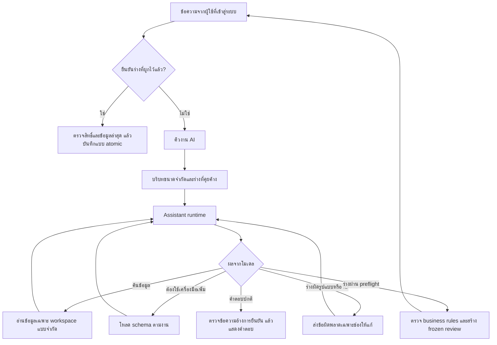

# โครงสร้าง AI Chat และผลการปรับปรุง

วันที่ 11 ตุลาคม 2026 — โฟกัสความต่อเนื่องของบทสนทนา การเรียก tools และต้นทุนบริบท ไม่รับรองคุณภาพโมเดลจริงจากผล mock tests

## จุดที่ตรวจพบและแก้แล้ว

| ปัญหาเดิม | การเปลี่ยนแปลง |
|---|---|
| ส่งคำสั่งยาวและ schema จัดการทุกประเภททุกครั้ง | แยก core tools กับ `load_toolkit`; เรียก management เมื่อจำเป็น และเปิด corrections หลังค้นรายการหรือโหลดเอง |
| ร่างผิดชนิดข้อมูล/ID แล้วจบด้วยให้ผู้ใช้เริ่มใหม่ | ตรวจ schema และ account references ก่อนส่งออกจาก runtime ส่ง field errors ที่ไม่รวม input กลับให้โมเดลแก้ ภายในขอบเขตจำกัด |
| อ้างอิงร่างที่ถามค้างผ่านประวัติข้อความเป็นหลัก | เก็บ typed partial draft + ช่องที่ขาด 15 นาที รวมรายการทั้งหมดใน batch ส่งให้โมเดลเฉพาะห้อง/ผู้ใช้เดิม |
| cache แยกค่าที่เว้นกับค่า default และผลอ่านอาจหายจากบริบทเมื่อ retry | canonical read keys จาก typed models และใส่ผลที่ cache กลับใน tool protocol ของรอบใหม่ |
| จำกัดรอบเป็นส่วน ๆ แต่ retry/fallback เพิ่มจำนวนคำขอรวมได้มาก | จำกัดสูงสุด 8 model requests ต่อการประมวลผลหนึ่งงาน รวม retry/fallback; จำกัด reads สำเร็จ 3 ครั้ง และ invalid tool responses 2 ครั้ง |
| เตรียมรายการ/ใช้ defaults แล้วโหลด accounts ทั้ง workspace | อ่านเฉพาะ IDs/กฎที่ตรง ตรวจบัญชีเดียวด้วย limit 2 และเสนอชื่อไม่เกิน 6 ชื่อเมื่อถามเพิ่ม |
| หน้าแชทแสดงแค่กำลังคิด | SSE progress ระบุการค้นข้อมูล ตรวจร่าง แก้คำสั่ง และสรุป; ไม่ส่ง arguments หรือ private thinking |

## เส้นทางการทำงาน

- `assistant_context.py`: คำสั่งหลักและข้อมูลร่างที่ถามค้าง
- `assistant_tools.py`: catalog, discovery schema, typed preflight และ canonical read keys
- `assistant_runtime.py`: วงรอบอ่าน/แก้/เตรียม/ตอบ พร้อม request budget และ progress
- `chat_dialogue.py`, `assistant_management.py`, `assistant_finance.py`: ตรวจข้อมูลจริงและเตรียมร่างตามประเภทงาน
- `chat_actions.py`: authenticated confirmation, stale checks, idempotency และการบันทึกจริง

การโหลด schema เป็นการลดบริบท ไม่ใช่ขอบเขตสิทธิ์ เครื่องมือที่ลงทะเบียนทุกตัวต้องตรวจ tenant/user และกฎของงานตามเดิม โมเดลไม่สามารถเพิ่มเครื่องมือเองหรือยืนยันแทนผู้ใช้ การตรวจ preflight ไม่ใช่หลักฐานว่าร่างผ่าน business rules ทั้งหมดหรือบันทึกแล้ว

## ผลวัดขนาดบริบท

วัดด้วยชื่อ workspace ตัวอย่างเดียวกัน เฉพาะ system instruction + tool schemas เริ่มต้นใน UTF-8:

- ก่อน: 26,405 bytes (instruction 10,893)
- หลัง: 12,814 bytes (instruction 5,151)
- ลด 51.5%; ไม่รวมประวัติ รูป และผล tool ไม่ใช่การวัด tokens, latency หรือใบแจ้งหนี้ของ provider เมื่อโหลดชุดเพิ่มเติมบริบทจะใหญ่ขึ้นตามงาน

## ขอบเขตและงานต่อไป

- ร่างที่คุยค้างเป็น state จากข้อมูลที่ผ่าน schema ไม่ใช่การจำถาวรหรือหลักฐานธุรกรรม ล้างเมื่อสร้าง review/ยกเลิก และไม่ส่งเมื่อพ้น 15 นาที การยืนยันยังต้องอิง frozen review จริง
- จำนวน 8 คำขอเป็นขอบเขตในการประมวลผลหนึ่งครั้ง ถ้า worker crash และทำงานใหม่ยังไม่ใช่ durable billing cap งบใช้งานมีระบบ reserve/accounting เดิม
- Worker ยังถือ transaction/workspace write lock ระหว่าง inference การอ่านหน้าเว็บไม่รอ lock แล้ว แต่งานเขียนใน workspace เดียวกันอาจรอ งานถัดไปควรแยก inference ออกจาก transaction โดยใช้ durable usage reservation, request ownership/version และตรวจ membership/evidence ใหม่ก่อน commit ไม่ควรปลด lock อย่างเดียว
- parser ยังรับหนึ่ง tool call ต่อคำตอบ; lookup รวม queries ได้สามรายการ ไม่ได้เพิ่ม parallel tool calls หรือเปิด SQL อิสระ
- AI Lab เป็น synthetic provider smoke test ส่วน regression บทสนทนาต่อเนื่องทดสอบ runtime จริงกับ HTTP mocks การรับรอง Gemma/Ollama จริงต้องทดสอบจากเครื่องปลายทางและการตั้งค่าของผู้ใช้

## รายงาน Gemma และการแก้ compatibility รอบถัดมา

ผลจริงจากผู้ใช้พบ batch item ขาด `transactions.intent` ซ้ำ จึงให้รายการย่อยใช้ `create` เป็น default ส่วน intent ระดับคำขอยังจำเป็นต้องระบุ ไม่มีการเดายอดหรือ ID และ business validation/confirmation เดิมยังทำงานทั้งหมด

AI Lab ให้โอกาสแก้ prose ที่ไม่ได้เรียก prepare_transaction อีกหนึ่งรอบภายใน call/time budget เดิม ต้องได้ typed draft ที่ตรวจผ่านจริงจึงผ่าน ไม่บันทึกจากข้อความ และไม่เดายอดสลิปจากจำนวนที่โจทย์คาดหวัง

แยก finish_reason=length เป็น output_limit ทั้ง streaming และ JSON responses ของ runtime/lab เพื่อบอกให้ปรับ output tokens/Thinking ได้ตรงจุด ตัวเลข output ที่ estimated ใน diagnostics ใช้เพดานการตั้งค่าสำหรับ reservation ไม่ใช่จำนวน tokens ที่วัดจาก provider จึงแสดงคำอธิบายตรงหน้า UI

รายงานเดิมที่ไม่มีคำตอบ/finish_reason ไม่เพียงพอพิสูจน์ว่ารายเดือนผิดเพราะการแปลงหน่วยหรือข้อความถูกตัด และไม่อาจระบุสาเหตุ transactions invalid ของสลิปได้แน่ชัด การแก้นี้ไม่รับรองว่า Gemma ทุกรุ่นจะผ่านทุกโจทย์ ต้องทดสอบจริงหลังอัปเดต ไม่ผ่อนเกณฑ์ยอดเงินเพื่อทำให้ผลผ่าน

## เครื่องมือตอบยอดที่ตรวจสอบแล้ว

`answer_finance_summary` เป็น read-only terminal tool สำหรับคำถามยอดคงเหลือรวมและสรุปรายเดือนทั้ง workspace เครื่องมืออ่านผ่าน scoped lookup/report เดิม แล้วแสดงยอดจาก integer satang โดยตรง ไม่ต้องให้โมเดลคำนวณหรือเขียนจำนวนเงินซ้ำ ช่วยจบงานมาตรฐานในหนึ่ง model request เมื่อเลือกเครื่องมือนี้ รายเดือนมีรายรับ รายจ่าย ผลต่าง และสูงสุดห้าหมวด พร้อม evidence links จาก backend

เดือนผิดรูปแบบ/เดือนที่ไม่มีจริงและตัวกรองที่ไม่รองรับถูกปฏิเสธและส่งให้โมเดลแก้ ไม่ละเลยตัวกรองเงียบ ๆ คำถามเจาะบัญชีหรือวิเคราะห์ซับซ้อนยังใช้เครื่องมือค้นเดิม ไม่ใช่การรับรองตัวเลขในคำตอบอิสระของโมเดลทั้งหมด และการเลือกเครื่องมือยังขึ้นกับโมเดล AI Lab รองรับเครื่องมือนี้ด้วยข้อมูลสังเคราะห์ ไม่มีการเขียนบัญชีหรือสร้างร่างจากคำถามรายงาน

## Audit fixes — 12 ตุลาคม 2026 (แทนข้อจำกัดเรื่อง write lock ข้างต้น)

- `assistant_evidence.py` ตรวจขอบเขตจากคำขอผู้ใช้และบริบทที่ backend ตรวจแล้ว: ยอดปัจจุบัน/ช่วงรายรับรายจ่าย, บัญชี/หมวด, วันที่ และการถามต่อที่ยังไม่หมดอายุ คำถามไม่ชัด หลายบัญชี/หมวด หรือยอดย้อนหลังที่ยังไม่รองรับต้องถามเพิ่ม ไม่แปลงเป็นยอดรวมเงียบ ๆ
- คำตอบการเงินในเส้นทางที่รองรับสร้างจาก scoped backend reads หรือรายการที่เครื่องมืออ่านได้ ไม่ใช้จำนวนเงินใน free prose ของโมเดล ข้อความอ้างทำสำเร็จไม่มีสิทธิ์เป็นหลักฐานบันทึก การบันทึกจริงยังอยู่ใน confirmation endpoint เท่านั้น งาน mutation ต้องส่ง typed draft; หากโมเดลไม่ทำ ระบบไม่อ้างว่างานเสร็จ
- Raw assistant streaming previews ถูกพักไว้ ส่งเฉพาะ progress และคำตอบที่ commit แล้ว เพื่อไม่ให้ยอด/คำอ้างผิดหลุดขึ้นจอชั่วคราว ปุ่มหยุดยังใช้ durable control เดิม
- Cache hit และ read limit ใช้ renderer ที่ตรงกับคำถาม/ข้อมูลล่าสุด ไม่เลือก balances เพียงเพราะเคยอ่านไว้ และไม่เรียกโมเดลเพิ่มเพื่อเขียนตัวเลขซ้ำ
- AI Lab ใช้ `assistant_runtime.converse` เดียวกับแชท ผ่าน synthetic adapter ที่ไม่มีสิทธิ์อ่านบัญชีจริงหรือสร้างร่างใน DB ผลผ่านหมายถึงผลลัพธ์หลังตรวจ ไม่ใช่การรับรองข้อความดิบของโมเดล เลิกตรวจแค่ว่ามีเลขที่คาดหวังอยู่ในข้อความ
- Worker ใช้ connection-scoped advisory ownership ต่อ job/workspace แทน workspace row lock ระหว่าง network inference ไม่ flush mutations ขณะรอ; HTTP writes ทำงานได้ และ worker สอง thread ทำต่าง workspace ได้ (AI_WORKERS 1–4, default 2)
- Usage reservation อยู่ใน transaction สั้นแยกต่างหากและ commit ก่อนส่งคำขอ ถ้า process crash ยอดจองยังอยู่เพื่อไม่ให้ overspend; ไม่ลดค่า reservation ที่ไม่ทราบ usage จริงอัตโนมัติ
- Migration `ai_evidence_epoch` เพิ่ม counter ที่ trigger เปลี่ยนเมื่อข้อมูลการเงิน/สิทธิ์/การตั้งค่าที่เกี่ยวข้องเปลี่ยน ก่อน commit ต้องล็อก workspace ช่วงสั้น ตรวจ epoch, membership, job/room existence, current user turn, room context และ stop fence ถ้าข้อมูลเปลี่ยนให้ยกเลิกผลเก่าและแจ้งส่งใหม่ การยืนยันร่างยังตรวจ stale/duplicate ตามเดิม
- Provider connection probe ปล่อย HTTP authorization lock ก่อน network I/O งานเก่าที่มีคำขอใหม่กว่าไม่เรียกโมเดลและไม่ทับ review ใหม่

ข้อจำกัดที่ยังต้องทราบ: การตีความภาษาธรรมชาติไม่ได้รองรับทุกประโยค ถ้าระบุขอบเขตไม่ได้ระบบขอเพิ่ม ไม่รับรองคุณภาพ Gemma จาก mocks และยังเก็บ read transaction/connection ระหว่าง inference (ไม่มี workspace write lock) Schema/catalog ยังคงหนึ่ง tool call ต่อ model reply ต้องทดสอบกับ provider จริงต่อ จำนวน request cap ยังต่อ processing attempt; ค่าใช้จ่าย reserve คงอยู่ข้าม crash แต่ไม่ได้อ้างว่า provider ยกเลิกคิดเงินเมื่อกดหยุด
