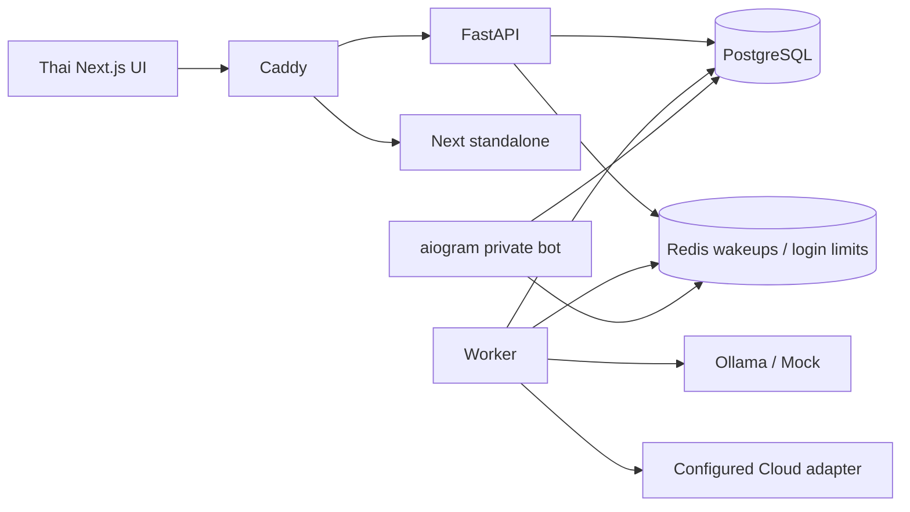
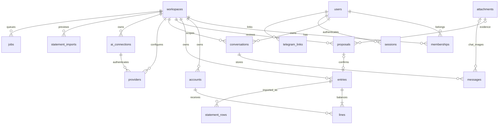

# Architecture and data rules

Authenticated transaction, proposal/chat-action confirmation and statement-import confirmation routes post through the ledger service after validating workspace access and explicit user confirmation. AI modules have no posting tools. AI text/JSON/images are untrusted data. Pydantic constrains extracted fields; extra output fields cannot create accounts, select financial accounts, grant permissions or trigger actions. Human confirmation supplies transaction fields and resolves workspace-local account IDs anew.

Workspace scoping is explicit in every query. Cross-entity tenant references have composite foreign keys on `(id, workspace_id)`. There is no implicit global workspace state on the backend. Provider API keys never leave the backend and are decrypted only immediately before the configured HTTP request.

The PostgreSQL ledger has deferred balance checks at commit, immutable entry/line triggers, and a transaction identity guard preventing line appends to an earlier journal. The application serializes financial writes using a workspace lock and commits before returning success. Journal posting must run in the outer DB transaction: the insertion guard compares the entry's xmin with the current top-level transaction ID; posting inside a database savepoint is not supported. Workers use savepoints for proposal processing only, and never post journals.

Database jobs form a durable outbox. Redis carries wakeups, not user content. Workers poll as a fallback and lock jobs with `FOR UPDATE SKIP LOCKED`, retaining the lock through bounded AI processing. Process crashes roll back the job and partial proposals; the job is available to retry after connection closure. Multiple workers can process separate jobs. Run one worker in milestone 1 to preserve chat request order; conversation-specific ordering across multiple workers is pending. After completion/failure, job payloads are cleared; normal chat messages and receipt attachments remain durable. The system does not promise exactly-once calls to external models after a worker crash, but a model call cannot post money.

Amounts are signed integer satang: debit positive, credit negative. Account balances use debit minus credit, reversing normal display for liability/income/equity. Reports derive from immutable ledger entries/lines and exclude opening/transfer/card payment from income/expense totals. Month boundaries use Asia/Bangkok and transaction dates are local calendar dates. No exchange rates or multi-currency conversion.

Threat limits: the server/database administrator is trusted; database role ownership bypasses any application restriction. No RLS, MFA, password recovery, tamper-proof external audit sink, configurable retention or formal penetration test is delivered. Login IP limits apply to the proxy peer in default Compose (forwarded IP headers are intentionally not trusted), so repeated login attempts can temporarily throttle the whole self-hosted instance. This conservative limit is appropriate to the initial single-user deployment and needs trusted-proxy configuration before larger deployment.

Source references used for implementation: [Next installation](https://nextjs.org/docs/app/getting-started/installation), [SQLAlchemy transactions](https://docs.sqlalchemy.org/en/20/orm/session_transaction.html), [FastAPI security](https://fastapi.tiangolo.com/tutorial/security/), [Gemini compatible API](https://ai.google.dev/gemini-api/docs/openai), [Ollama compatible API](https://docs.ollama.com/api/openai-compatibility).

## Image messages

Chat uploads use a separate authenticated multipart endpoint. Each message references an attachment through `(attachment_id, workspace_id)` and keeps its caption in conversation history. The server obtains privacy from the owned conversation, never from an upload-provided override. The extract worker validates ownership and active membership, sends only the current image/caption to the configured vision provider, then inserts pending proposals and an assistant acknowledgement in one transaction. A workspace lock serializes image deduplication before insertion. Model text has no posting capability.

Before extraction creates shared Inbox evidence, image access requires the owning conversation or the uploader's pending job. Inbox proposals and their receipt evidence are shared workspace finance data, as disclosed beside the chat composer. Deleting a conversation cancels its pending jobs and removes history; shared receipt evidence is retained. Orphan attachment retention remains pending.

Open chat rooms poll history independently of whether a pending job was observed, covering a worker that completes between the initial history request and the job refresh. Room polling cancels stale responses when the active room changes.

### Demand-driven Web Assistant reads

Configured Web Chat starts with bounded text history and workspace/date instructions, without eager account balances or management-plan snapshots. `lookup_workspace` uses server-bound tenant and room owner, strict typed resource/filter allowlists, literal name search and UUID keyset pages (10 default,20 max,3 resources/batch). Personal preferences are owner-scoped and keyword-filtered. `query_finance` uses active journals only, cursor pages of10 and366-day maximum ranges. Valid anchors must exist inside the current tenant and filters. Page state lives in the existing room context for15minutes and is included only on relevant follow-ups.

AI monthly reports use dedicated SQL totals and streamed group/budget hashing; output retains top20 rows per group plus complete group counts. No dashboard balances/daily/recent feed is computed. Full fingerprints include groups outside display limits, so stale analytical plans still fail confirmation. Read results are cached only in the job object for that turn. Provider calls/retries remain metered and bounded. Current attachments or short explicit/receipt-clarification follow-ups within15minutes may send image bytes, rather than automatically sending recent images with unrelated chat. This is bounded retrieval, not automatic long-term memory or a large-data latency guarantee.

### Owner-configured AI network destinations

Ollama supports a per-provider endpoint, falling back to the trusted server OLLAMA_URL when blank. Custom and Ollama endpoints accept HTTP(S), explicit ports, LAN, loopback, Docker names and Tailscale CGNAT destinations. This intentionally grants workspace owners access to these AI destinations from the backend network; do not treat owner configuration as an untrusted tenant URL sandbox. Custom endpoints validate syntax and every resolved address, pin DNS, retain original Host/port and HTTPS SNI, and reject link-local/metadata, unspecified, multicast and reserved destinations. Named cloud providers retain public-only resolution. All calls disable redirects and environment proxies; keys are backend-only and cleared when destination changes without a replacement key. Cloud-off still permits configured Ollama destinations, including remote machines.

### Chat cancellation

`chat_generations` stores an immutable job/room association and a durable stop flag, including after Job.payload is scrubbed. Stop authenticates the session, current membership, active workspace and room owner using a short read-only authorization snapshot like SSE. It intentionally avoids Workspace FOR UPDATE because the worker owns that lock during inference. Stop locks only the generation row, then attempts Job FOR UPDATE SKIP LOCKED to cancel queued work immediately when the workspace is free. If another room owns the workspace lock, the durable flag is acknowledged immediately and the queued job cancels itself when picked up; the stop request never waits to insert a notice through a locked workspace foreign key. Running workers poll the flag with independent short DB sessions, attempt to close an open upstream response, and lock/recheck the generation row before resolving any draft or storing the answer. The final fence is held through commit: stop wins before draft creation or returns the already committed job status. Worker savepoint rollback removes incomplete context/actions and retains usage accounting. Redis stopping/cancelled notices are ephemeral; DB status/history remain authoritative. Upstream execution/billing cancellation is not guaranteed. No new ledger-writing tool or auto-confirm path is introduced.

### Reads while inference is pending

Workspace authorization for GET/HEAD/OPTIONS checks the committed workspace, archive status and current membership without acquiring Workspace FOR UPDATE, like SSE authorization. This lets dashboard, accounts, jobs, history and settings read committed data while the worker waits on upstream headers or tokens. Mutating requests retain the workspace authorization lock and all ledger/membership write guards. Reads do not expose the worker's uncommitted drafts or usage rows. A read authorized before a concurrent membership revocation may finish; subsequent requests recheck membership. This change does not move AI inference outside its existing transaction: writes to that workspace can still wait until inference ends or is stopped.

### Current balance totals and bounded synthesis

`balances.summary` is a workspace-scoped SQL aggregate over matching asset/liability accounts and ledger lines, independent of cursor/page size, including zero-balance accounts in its count. It exposes assets, liabilities and net in integer THB satang; filter scope is explicit. Per-account rows remain paginated. Repeated cached reads stop the loop without further DB reads. A verified balance summary can produce a deterministic Thai balance reply; otherwise a final request without tools summarizes existing tool outputs. No tools returned by that final request are executed. Normal read→draft workflows still use the existing four-round loop and confirmation gate; at most one extra final text request is allowed within the existing deadline and usage reservation.

### Synthetic AI lab and diagnostics

Owner-scoped `/workspaces/{wid}/ai/tests` enqueues `ai_test`; the worker calls the configured chat providers but substitutes fixed synthetic tool results and validates draft arguments without invoking any ledger/action resolver. No real chat/finance context is supplied. Usage remains accounted and cloud/budget policy applies. Per-job metadata is a whitelist (up to 40 events), persisted separately from scrubbed payloads with 30-day expiry; indexed workspace/time reads return at most 50 recent jobs. Owner-only diagnostics endpoints never expose content, arguments, endpoints or encrypted keys. Worker cleanup clears expired metadata in bounded batches. The lab detects known structural and fixture-answer failures; it does not certify general model quality.

## CSV ingestion and reusable AI connections (20 October 2026)

`statement_imports` stores a user-owned normalized preview for one asset account. Raw CSV bytes are not retained. Explicit confirmation revalidates categories and duplicate markers under the existing workspace write lock, posts the selected entries atomically and records `statement_rows` with scoped fingerprints and entry foreign keys. Replays return the saved result; changed selections after confirmation conflict. Unconfirmed previews expire after 24 hours and are removed by worker cleanup. Confirmed previews and row markers remain as import audit data. This flow never calls AI.

`ai_connections` owns one workspace endpoint and encrypted credential. Linked Provider rows retain model/task parameters, IDs, routing and usage references; their legacy credential field is empty. Every runtime/probe/lab request resolves the key from the linked workspace connection. Endpoint/kind mirrors are updated atomically for linked profiles when a connection changes. Key-only changes also advance the workspace AI epoch. The composite FK prevents connections across workspaces. Old per-model API payloads remain supported; migration keeps old connections separate to avoid merging different credentials at the same URL.
